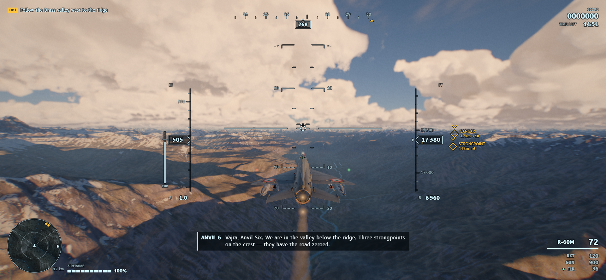
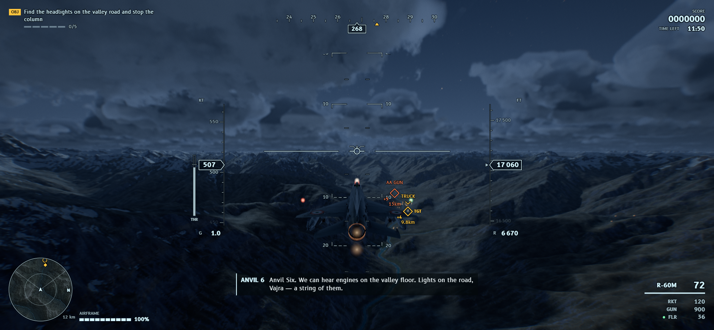
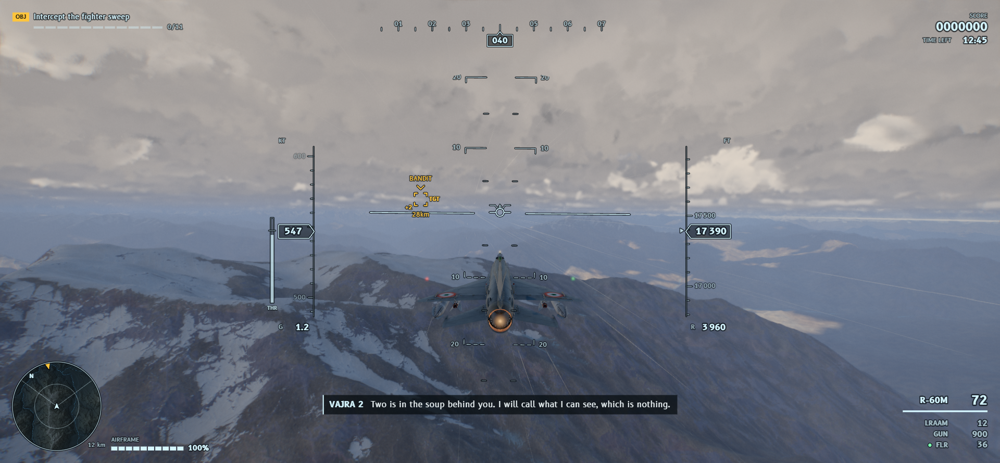

# Safed Sagar

**A WebGPU arcade air-combat game flown over the real Kargil Himalaya.**

Fly a MiG-21 through six sorties across the Drass, Kargil and Batalik sectors:
ridge strikes, night interdiction against convoys, low-level photo reconnaissance
under radar, an intercept inside a thunderstorm and a final fight over Tiger Hill.
The ground under you is real NASA SRTM elevation data. The sky, the weather and
the time of day change from one mission to the next.



<table>
  <tr>
    <td width="50%"></td>
    <td width="50%"></td>
  </tr>
</table>

Built on [three.js](https://threejs.org) r187 with the WebGPU renderer and TSL
node materials. When WebGPU is not available, it falls back to WebGL2
automatically. It is a static site with no server component.

---

## Quick start

You need **Node 20.19+ or 22.12+** (Vite 8). A WebGPU browser (current Chrome
or Edge) gives the full look; any WebGL2 browser runs the fallback.

```bash
npm install
npm run dev        # http://127.0.0.1:5173
npm test           # node:test suites next to the code
npm run build      # static bundle in dist/
npm run preview
```

Useful URL flags:

| Flag | Effect |
| --- | --- |
| `?mission=m1` | jump straight into a sortie (`m1`, `m2`, `night`, `m3`, `storm`, `m4`, `free`) |
| `?quality=low\|medium\|high\|ultra` | force a quality tier (otherwise auto-detected; saved in Settings) |
| `?webgl` | force the WebGL2 backend |
| `?difficulty=easy\|normal\|hard` | difficulty |
| `?tod=HH:MM\|dawn\|noon\|golden\|dusk\|night\|cycle` | time of day (Free Flight) |
| `?perfhud` | GPU ms per pass and CPU ms per system (Shift+F3 toggles) |
| `?actioncam` | cinematic action camera |

---

## Controls

Keyboard and mouse, gamepad (standard mapping) and touch all work. Bindings
are shown in the briefing and can be changed in Settings.

| Action | Keyboard / mouse | Gamepad |
| --- | --- | --- |
| Pitch | `W` / `S` (nose down / up), arrows | left stick |
| Roll / turn | `A` / `D`, arrows | left stick |
| Yaw | `Q` / `E` | LB / RB |
| Throttle up / afterburner | `Shift` | RT |
| Airbrake (hold and pull for a high-G turn) | `Ctrl` / `Z` | LT |
| Gun | `F` / left mouse | A |
| Missile / special weapon | `Space` / right mouse | B |
| Switch weapon | `R` | X |
| Flares | `X` | L3 |
| Next target | `Tab` / `T` | Y |
| Camera (chase, cockpit, ...) | `C` | Back |
| Look at target (hold) | `G` | R3 |
| Missile camera | `B` | D-pad right |
| Recon optic (hold) | `V` | D-pad up |
| Standard / Expert flight controls | `M` | D-pad down |
| Pause | `Esc` / `P` | Start |

**Standard** controls fly a turn-rate assist with envelope protection. **Expert**
controls give you the airframe directly.

---

## The campaign

| # | Sortie | Conditions | What you do |
| --- | --- | --- | --- |
| 1 | **First Light** (Tololing, above Drass) | 05:40 dawn, scattered cloud | ingress, ridge strike, convoy, defend against bandits; tutorial hints over the radio |
| 2 | **River of Stone** (Batalik, above the Indus) | midday, building cumulus | close support for troops on the crest, then an intercept |
| 3 | **Black Road** (Drass valley road) | 22:40 night, clear | find two convoys by their headlights, then night fighters |
| 4 | **Long Lens** (Drass to Kargil ridges) | golden hour, overcast | photograph four observation posts under search radar, bring the film home |
| 5 | **Thunderhead** (above Kargil) | afternoon storm | eleven-fighter sweep in turbulence, rain and lightning |
| 6 | **Tiger's Teeth** (Tiger Hill) | dusk turning to moonlit night | summit strike, survive the four-ship Irbis flight, finish the hill |
| — | **Free Flight** | pick any time and weather | open practice range |

Easy, Normal and Hard scale enemy accuracy and tempo, damage taken, missile
performance and score. The weather does more than change the look:
- turbulence shakes the jet and spreads enemy gunfire;
- heat-seekers lose targets inside cloud;
- darkness and murk shorten how far gunners and pilots can see;
- defensive pilots run for cloud cover.

Every sortie was flown repeatedly by an automated bot pilot to tune it. On
Normal it now wins every run of M1, M2 and Black Road, and most runs of the
others (`docs/v2/evidence/polish-gameplay/`).

---

## What is in here

**Terrain.** Real SRTM elevation for N34E075 and N34E076, from Drass to Batalik,
packed into two resolution levels. It is drawn through a geomorphing GPU clipmap
with Poly Haven CC0 ground layers, slope and altitude snow, and rivers traced
from flow accumulation. A CPU mirror of the same heightfield answers line of
sight, terrain clearance and AI queries, and agrees with the rendered surface to
under 0.1 m.

**Sky, atmosphere and time of day.** A physically based atmosphere (after
Hillaire 2020) with aerial perspective, and a full solar and lunar clock for the
real latitude:
- dawn alpenglow, a twilight Earth shadow, and the moon as key light with its
  correct phase;
- about 8,900 catalogue stars, a procedural Milky Way and airglow on moonless
  nights;
- village lights in the valleys, and nav lights and convoy headlights.

Night exposure and colour grading follow the light level.

**Clouds and weather.** Volumetric raymarched clouds (Nubis-style) with
temporal reprojection, cloud shadows on terrain and aircraft, and a fly-through
interior with light falloff. `env.weather` drives:
- rain shafts and in-cloud lightning;
- near-camera rain and snow;
- vapour and wind drift.

**Aircraft.** The MiG-21 has painted-metal PBR with clearcoat, a clear canopy
over a full cockpit interior, and moving stabilators, ailerons and flaps that
follow the flight model. Hostile fighters are unmarked and use a two-tone grey
derivative of the same model. Ground units sit on the slope, track their targets
and leave burning wrecks.

**Effects.** GPU compute particles and ribbons:
- six-way-lit smoke and fire;
- afterburner from the measured nozzle;
- wingtip vapour and contrails;
- tracers from live rounds;
- flak, explosions with scaled shockwaves, and burning wreck smoke.

Effects respect cloud occlusion and soft-clip against the terrain. Particle pools
cost nothing when idle.

**Camera and post-processing.** These work as one pipeline:

| Area | What it does |
| --- | --- |
| Cameras | chase, cockpit (first person), look-at-target, missile, kill and death cameras, plus an optional action cam; spring-damped chase with camera lag, G-driven FOV and shake, and a sonic-boom moment |
| Image | TRAA anti-aliasing, tiled per-object motion blur, depth of field for the cinematic cameras, bloom, auto-exposure, a lens flare that only the sun throws, AgX tone mapping and a filmic grade |
| Weather on the lens | simulated water on the canopy (drops, runs and drying), frost, and speed streaks |

**Audio and music.** A Web Audio engine with spatialised engine, gun, missile,
explosion, warning and radio sound. The music is an original score rendered
offline from the CC0 VSCO 2 CE and VCSL sample libraries, and it moves between
calm, tension and combat states.

**Interface.** Original HUD (tapes, ladder, target markers that stay clear of
the instruments, threat warnings), briefing with a conditions line, debrief and
ranks, settings with rebinding, and phone layouts in portrait and landscape.

---

## Performance

Measured with GPU timestamp queries, busy combat, on an RTX 5090:

| Tier | 1080p | 1440p |
| --- | --- | --- |
| low | 0.6 ms | 1.0 ms |
| medium | 0.8 ms | 1.2 ms |
| high | 1.0 ms | 1.3–2.0 ms |
| ultra | 1.1 ms | 1.6 ms |

Mid-range and integrated GPUs are estimated, not measured. Adaptive resolution
holds a 13.5 ms GPU budget (render scale 0.6–1).

**Robustness:**
- device loss and context loss show a reload overlay; a second loss offers the
  WebGL2 compatibility mode;
- memory stays flat across repeated sortie/retry cycles;
- full sorties were completed on the WebGL2 fallback.

Details and tooling: `docs/v2/evidence/polish-perf/README.md` and
`tools/perf/README.md`.

---

## Project layout

```
src/
  engine/     Renderer (WebGPU/WebGL2), quality tiers, PostFX, GPU profiler, adaptive resolution
  core/       boot lifecycle, input and bindings, touch controls, settings
  game/       Game orchestrator (fixed 120 Hz physics), events, flow state machine, dev bot
  world/      terrain + heightfield, atmosphere, clouds, weather, time of day, Environment
  flight/     flight model, assist, aircraft and sockets
  camera/     camera rigs and modes
  combat/     weapons, missiles, guns, damage
  ai/         fighters, ground units, sites
  missions/   mission data, runner, conditions, radio cast, scoring
  vfx/        GPU particle pools, ribbons, tracers, shells, explosions
  audio/      engine, SFX, music
  ui/         HUD, menus, briefing, debrief, settings
  timeofday/  night lights and exposure system
tools/        terrain DEM build, Blender asset scripts, audio rendering, star data, perf
public/       models, terrain packs, textures, audio, fonts, notices
docs/v2/      ARCHITECTURE.md (system contract) and evidence/ (screenshots, measurements)
```

Systems register themselves (`src/*/system.js`, discovered with
`import.meta.glob`) and talk through `game.events`. Each one reads its budget
from the quality tier. `docs/v2/ARCHITECTURE.md` is the contract between them.

---

## Credits and licences

This project's own code is MIT; see [LICENSE](LICENSE). Full third-party
notices ship with the build in
[`public/THIRD_PARTY_NOTICES.txt`](public/THIRD_PARTY_NOTICES.txt).

**Models**
- **Aircraft model:** ["MiG-21 Bison Indian (War Thunder)"](https://sketchfab.com/3d-models/mig-21-bison-indian-war-thunder-eaefc619a50047a0acf4af12cd269b92)
  by [KojfDiscord](https://sketchfab.com/KojfDiscord), CC BY 4.0, optimised for
  the web. The hostile livery is a derivative with markings removed.

**Terrain and sky data**
- **Elevation:** NASA SRTM (public domain).
- **Ground textures:** Poly Haven (CC0).
- **Stars:** d3-celestial (BSD-3-Clause, Hipparcos-derived).

**Audio**
- **Music samples:** VSCO 2 Community Edition and the Versilian Community Sample
  Library (CC0).
- **Sound effects and synthesised instruments:** original to this project.

**Code and fonts**
- **GPU particle and ribbon code:** adapted from
  [LinearAbiltyCastingThreeJS](https://github.com/achrefelouafi/LinearAbiltyCastingThreeJS) (MIT).
- **Typefaces:** B612, B612 Mono and Big Shoulders Display (OFL).
- **three.js** (MIT).

The atmosphere, clouds, terrain and time-of-day models are original
implementations of published techniques. No code is reused from those works.

## A note on the subject

Safed Sagar is inspired in tone and setting by the 1999 Kargil conflict and by
Operation Safed Sagar, the Indian Air Force's part in it.

It is a **work of fiction**. It is not affiliated with, endorsed by, or
representing the Indian Air Force, the Indian Army or the Ministry of Defence.
Hostile forces are fictional, unnamed and unmarked. Every callsign, unit and
event in the game is invented.

Remembrance is kept separate from score. The memorial card carries no
statistics, and the mission result carries no memorial.

> Inspired by the courage and sacrifice of the Indian Armed Forces during the
> Kargil War. With special respect to the Indian Air Force personnel who flew
> Operation Safed Sagar in support of soldiers fighting on the ground. In
> remembrance of all those who made the supreme sacrifice in service of India.
>
> **Jai Hind.** 🇮🇳
