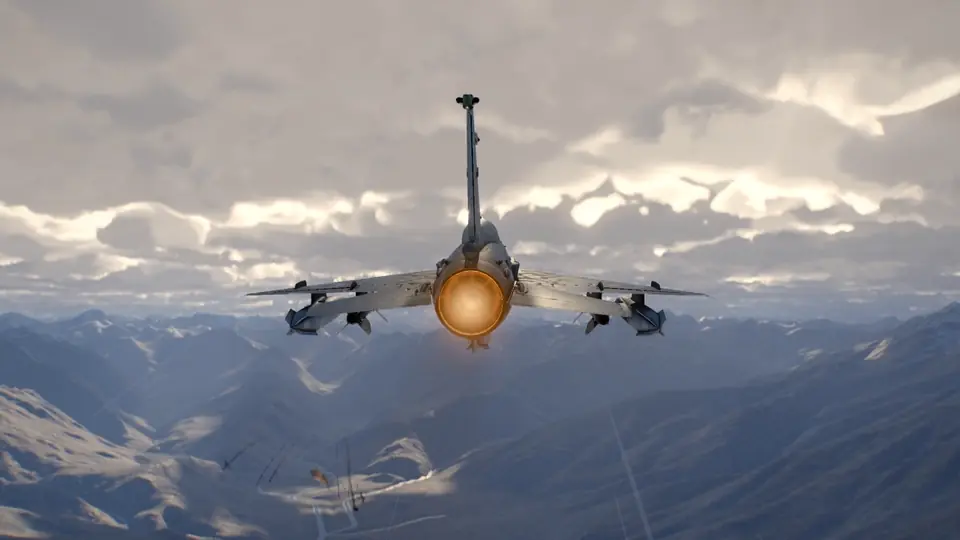
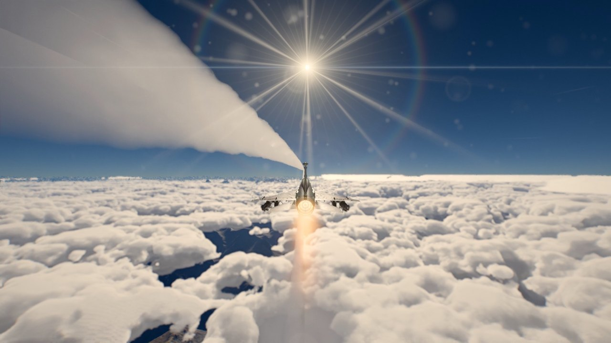
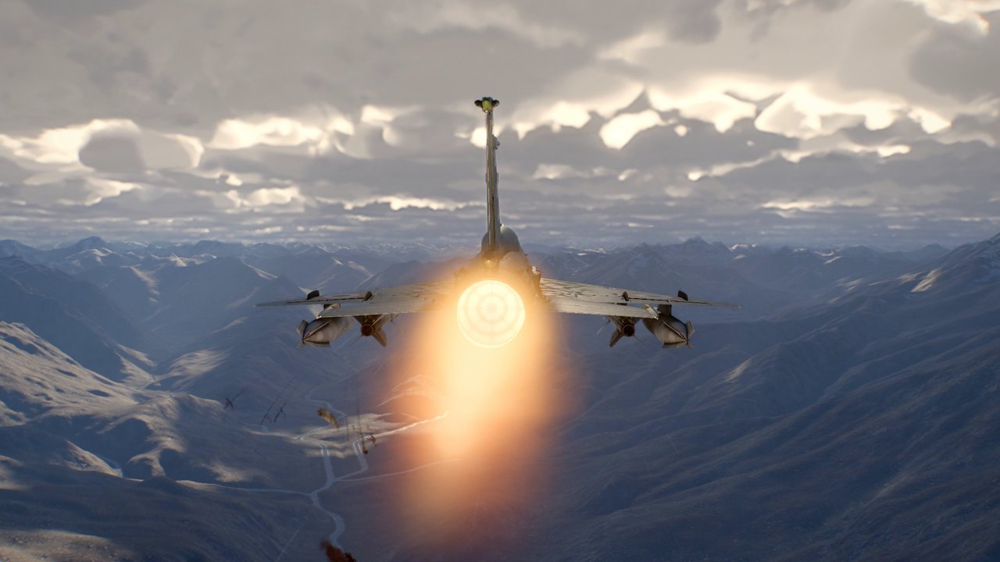
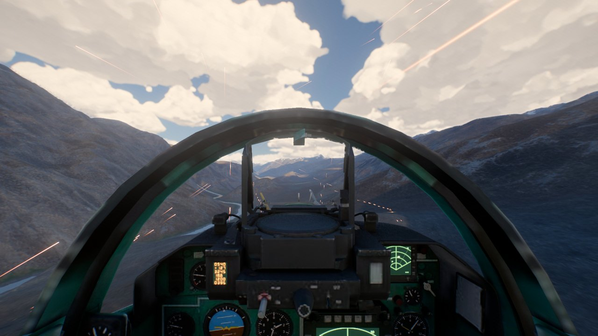
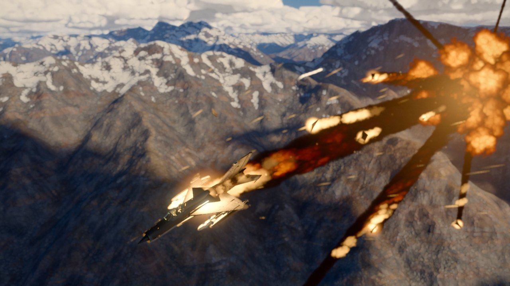
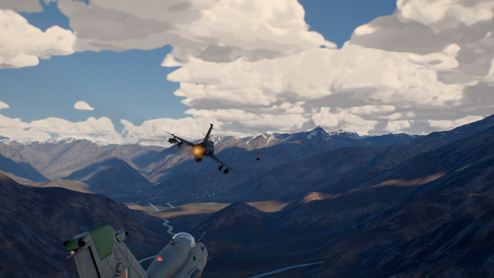
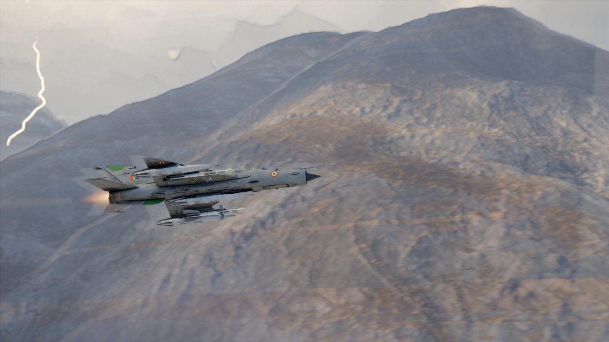
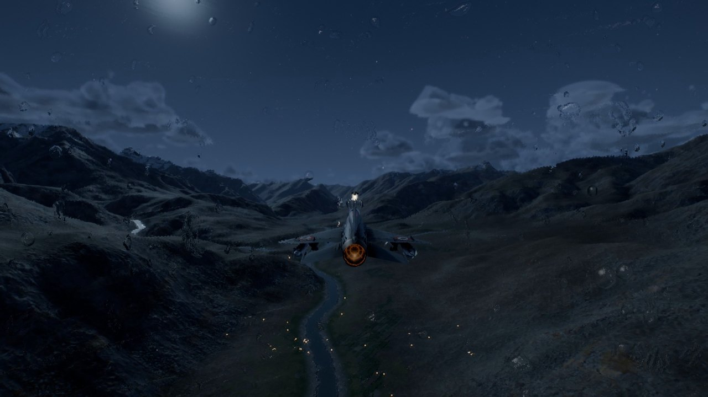
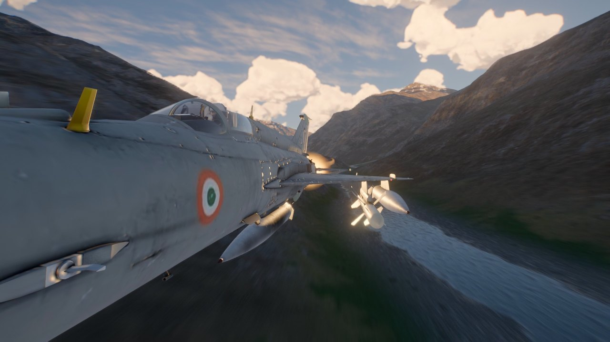

# Safed Sagar

**Fly a MiG-21 through the real Kargil Himalaya. In your browser. No install.**

[](docs/media/trailer.mp4)

### [▶ Play it now](https://oss-web-3d.vercel.app) · [🎬 Watch the 57-second trailer](docs/media/trailer.mp4)

---

## ⚡ The 30-second version

- **What:** an arcade air-combat game. Six sorties, plus Free Flight.
- **Where:** the real terrain around Drass, Kargil and Batalik (NASA elevation data).
- **How it looks:** volumetric clouds, dawn to moonlit night, storms with lightning, a full cockpit.
- **Tech:** three.js r187, WebGPU and TSL shaders, with an automatic WebGL2 fallback.
- **Cost:** free and open source (MIT). It is a static site with no server.

---

## 📸 Screenshots

| | |
| --- | --- |
|  |  |
|  |  |
|  |  |
|  |  |

Every image is captured in the game. Nothing is painted over.

---

## 🚀 Run it locally

You need **Node 20.19+ or 22.12+**. Current Chrome or Edge gives the full WebGPU
look; any WebGL2 browser runs the fallback.

```bash
npm install
npm run dev        # http://127.0.0.1:5173
```

| Command | What it does |
| --- | --- |
| `npm test` | runs the `node:test` suites that sit next to the code |
| `npm run build` | writes the static bundle to `dist/` |
| `npm run preview` | serves that bundle |

<details>
<summary><b>URL flags</b> (skip menus, force a quality tier, and more)</summary>

| Flag | Effect |
| --- | --- |
| `?mission=m1` | jump straight into a sortie (`m1`, `m2`, `night`, `m3`, `storm`, `m4`, `free`) |
| `?quality=low\|medium\|high\|ultra` | force a quality tier (otherwise auto-detected; saved in Settings) |
| `?webgl` | force the WebGL2 backend |
| `?difficulty=easy\|normal\|hard` | difficulty |
| `?tod=HH:MM\|dawn\|noon\|golden\|dusk\|night\|cycle` | time of day (Free Flight) |
| `?perfhud` | GPU ms per pass and CPU ms per system (Shift+F3 toggles) |
| `?actioncam` | cinematic action camera |

</details>

---

## 🎮 Controls

Keyboard and mouse, gamepad and touch all work. You can rebind keys in Settings.

**The five you need:**

| Action | Keyboard / mouse | Gamepad |
| --- | --- | --- |
| Fly | `W` `A` `S` `D` or arrows | left stick |
| Throttle up / afterburner | `Shift` | RT |
| Gun | `F` or left mouse | A |
| Missile | `Space` or right mouse | B |
| Flares | `X` | L3 |

<details>
<summary><b>All controls</b></summary>

| Action | Keyboard / mouse | Gamepad |
| --- | --- | --- |
| Pitch | `W` / `S` (nose down / up), arrows | left stick |
| Roll / turn | `A` / `D`, arrows | left stick |
| Yaw | `Q` / `E` | LB / RB |
| Throttle up / afterburner | `Shift` | RT |
| Airbrake (hold and pull for a high-G turn) | `Ctrl` / `Z` | LT |
| Gun | `F` / left mouse | A |
| Missile / special weapon | `Space` / right mouse | B |
| Switch weapon | `R` | X |
| Flares | `X` | L3 |
| Next target | `Tab` / `T` | Y |
| Camera (chase, cockpit, ...) | `C` | Back |
| Look at target (hold) | `G` | R3 |
| Missile camera | `B` | D-pad right |
| Recon optic (hold) | `V` | D-pad up |
| Standard / Expert flight controls | `M` | D-pad down |
| Pause | `Esc` / `P` | Start |

- **Standard** controls fly a turn-rate assist with envelope protection.
- **Expert** controls give you the airframe directly.

</details>

---

## 🗺️ The campaign

| # | Sortie | When and weather | Your job |
| --- | --- | --- | --- |
| 1 | **First Light** (Tololing) | 05:40 dawn, scattered cloud | ridge strike, a convoy, then bandits; the radio teaches you as you go |
| 2 | **River of Stone** (Batalik) | midday, building cumulus | close support on the crest, then an intercept |
| 3 | **Black Road** (Drass valley) | 22:40 night | find two convoys by their headlights, then night fighters |
| 4 | **Long Lens** (Drass to Kargil) | golden hour, overcast | photograph four posts under search radar and bring the film home |
| 5 | **Thunderhead** (above Kargil) | afternoon storm | an eleven-fighter sweep in rain, turbulence and lightning |
| 6 | **Tiger's Teeth** (Tiger Hill) | dusk into moonlit night | summit strike, then survive a four-ship |
| — | **Free Flight** | any time, any weather | an open practice range |

**Weather is gameplay, not just looks:**
- turbulence shakes the jet and spreads enemy gunfire;
- heat-seekers lose targets inside cloud;
- darkness and murk shorten how far gunners and pilots can see;
- defensive pilots run for cloud cover.

Easy, Normal and Hard scale enemy accuracy and tempo, the damage you take,
missile performance and score. An automated bot pilot flew every sortie many
times to tune the balance.

---

## ✨ What's inside

**At a glance:**

| Area | Highlights |
| --- | --- |
| 🏔️ Terrain | real SRTM elevation, a GPU clipmap, rivers traced from the data, snow by slope and altitude |
| ☁️ Sky | physically based atmosphere, a real sun and moon clock, about 8,900 stars, volumetric clouds |
| ⛈️ Weather | rain shafts, lightning, rain on the canopy, frost, wind drift |
| ✈️ Aircraft | PBR MiG-21, a full cockpit, control surfaces that move with the flight model |
| 💥 Effects | GPU particles: afterburner, vapour, tracers from live rounds, flak, fire and smoke |
| 🎥 Cameras | chase, cockpit, look-at-target, missile cam and kill cam |
| 🔊 Audio | spatial Web Audio, voiced radio, an original adaptive score |

<details>
<summary><b>Terrain</b></summary>

- Real SRTM elevation for N34E075 and N34E076, from Drass to Batalik, packed
  into two resolution levels.
- Drawn through a geomorphing GPU clipmap with Poly Haven CC0 ground layers,
  slope and altitude snow, and rivers traced from flow accumulation.
- A CPU mirror of the same heightfield answers line-of-sight, terrain-clearance
  and AI queries. It matches the rendered surface to within 0.1 m.

</details>

<details>
<summary><b>Sky, atmosphere and time of day</b></summary>

- A physically based atmosphere (after Hillaire 2020) with aerial perspective.
- A full solar and lunar clock for the real latitude:
  - dawn alpenglow and a twilight Earth shadow;
  - the moon as key light, with its correct phase.
- About 8,900 catalogue stars, a procedural Milky Way, and airglow on moonless
  nights.
- Village lights in the valleys, nav lights, and convoy headlights.
- Night exposure and colour grading follow the light level.

</details>

<details>
<summary><b>Clouds and weather</b></summary>

- Volumetric raymarched clouds (Nubis-style) with temporal reprojection.
- Cloud shadows fall on the terrain and the aircraft.
- You can fly through the clouds, and the light falls off inside them.
- `env.weather` drives rain shafts, in-cloud lightning, near-camera rain and
  snow, vapour and wind drift.

</details>

<details>
<summary><b>Aircraft and effects</b></summary>

- Painted-metal PBR with clearcoat, and a clear canopy over a full cockpit.
- Stabilators, ailerons and flaps follow the flight model.
- Hostile fighters are **unmarked**: a two-tone grey derivative of the same model.
- Ground units sit on the slope, track their targets and leave burning wrecks.
- GPU compute particles and ribbons:
  - six-way-lit smoke and fire;
  - afterburner from the measured nozzle;
  - wingtip vapour and contrails;
  - tracers from live rounds;
  - flak and shockwaves.
- Particles respect cloud occlusion, soft-clip against the terrain, and cost
  nothing when idle.

</details>

<details>
<summary><b>Camera and image pipeline</b></summary>

| Part | What it does |
| --- | --- |
| Cameras | chase, cockpit, look-at-target, missile, kill and death cameras, plus an optional action cam |
| Feel | spring-damped chase with lag, FOV and shake driven by G, a sonic-boom moment |
| Image | TRAA, per-object motion blur, depth of field on cinematic cameras, bloom, auto-exposure, a lens flare only the sun throws, AgX tone mapping |
| Lens | water on the canopy (drops, runs, drying), frost, speed streaks |

</details>

<details>
<summary><b>Audio and interface</b></summary>

- **Audio:** a Web Audio engine with spatialised engine, gun, missile,
  explosion, warning and radio sound.
- **Music:** an original score rendered offline from the CC0 VSCO 2 CE and VCSL
  sample libraries. It moves between calm, tension and combat.
- **Interface:**
  - an original HUD with tapes, a pitch ladder, threat warnings, and target
    markers that keep clear of the instruments;
  - a briefing, a debrief with ranks, and settings with key rebinding;
  - phone layouts in portrait and landscape.

</details>

---

## 📈 Performance

GPU time per frame in busy combat, measured with timestamp queries on an RTX 5090:

| Tier | 1080p | 1440p |
| --- | --- | --- |
| low | 0.6 ms | 1.0 ms |
| medium | 0.8 ms | 1.2 ms |
| high | 1.0 ms | 1.3–2.0 ms |
| ultra | 1.1 ms | 1.6 ms |

- **Other GPUs:** mid-range and integrated numbers are estimates, not
  measurements.
- **Adaptive resolution:** holds a 13.5 ms GPU budget, with the render scale
  between 0.6 and 1.
- **Lost GPU:** device or context loss shows a reload screen. A second loss
  offers the WebGL2 mode.
- **Memory:** stays flat across repeated sortie and retry cycles.
- **Fallback:** full sorties have been completed on WebGL2.

Tooling: [`tools/perf/README.md`](tools/perf/README.md).

---

## 🧭 Find your way around

```
src/
  engine/     renderer (WebGPU/WebGL2), quality tiers, PostFX, GPU profiler, adaptive resolution
  core/       boot, input and bindings, touch controls, settings
  game/       Game orchestrator (fixed 120 Hz physics), events, flow, dev hooks
  world/      terrain + heightfield, atmosphere, clouds, weather, time of day
  flight/     flight model, assist, aircraft and sockets
  camera/     camera rigs and modes
  combat/     weapons, missiles, guns, damage
  ai/         fighters, ground units, sites
  missions/   mission data, runner, conditions, radio cast, scoring
  vfx/        GPU particles, ribbons, tracers, explosions
  audio/      engine, SFX, music
  ui/         HUD, menus, briefing, debrief, settings
tools/        terrain DEM build, Blender asset scripts, audio rendering, frame capture, perf
public/       models, terrain packs, textures, audio, fonts, notices
trailer/      the trailer as a HyperFrames project (cut list, radio, titles)
docs/         ARCHITECTURE.md and the README media
```

- **How it fits together:** systems register themselves (`src/*/system.js`,
  found with `import.meta.glob`) and talk through `game.events`. Each one reads
  its budget from the quality tier.
- **More detail:** [`docs/ARCHITECTURE.md`](docs/ARCHITECTURE.md) covers the
  systems, events, HUD data, dev tools and design notes.
- **The trailer:** cut from frame-exact in-game captures (`tools/capture`). The
  footage itself is not committed. See [`trailer/SPEC.md`](trailer/SPEC.md).

---

## 🙏 Credits and licences

This project's own code is MIT; see [LICENSE](LICENSE). The full third-party
notices ship with the build in
[`public/THIRD_PARTY_NOTICES.txt`](public/THIRD_PARTY_NOTICES.txt).

**Models**
- **Aircraft:** ["MiG-21 Bison Indian (War Thunder)"](https://sketchfab.com/3d-models/mig-21-bison-indian-war-thunder-eaefc619a50047a0acf4af12cd269b92)
  by [KojfDiscord](https://sketchfab.com/KojfDiscord), CC BY 4.0, optimised for
  the web. The hostile livery is a derivative with the markings removed.

**Terrain and sky data**
- **Elevation:** NASA SRTM (public domain).
- **Ground textures:** Poly Haven (CC0).
- **Stars:** d3-celestial (BSD-3-Clause, derived from Hipparcos).

**Audio**
- **Music samples:** VSCO 2 Community Edition and the Versilian Community Sample
  Library (CC0).
- **Sound effects and synthesised instruments:** original to this project.
- **Trailer music:** "Noir Now" by Drakensson (CC0).
- **Trailer thunder:** "Thunder Clap 1" by jzielke011 (CC BY 4.0).

**Code and fonts**
- **GPU particle and ribbon code:** adapted from
  [LinearAbiltyCastingThreeJS](https://github.com/achrefelouafi/LinearAbiltyCastingThreeJS) (MIT).
- **Typefaces:** B612, B612 Mono and Big Shoulders Display (OFL).
- **three.js** (MIT).

The atmosphere, clouds, terrain and time-of-day models are original
implementations of published techniques. They reuse no code from those works.

---

## A note on the subject

Safed Sagar is inspired in tone and setting by the 1999 Kargil conflict and by
Operation Safed Sagar, the Indian Air Force's part in it.

It is a **work of fiction**. It is not affiliated with, endorsed by, or
representing the Indian Air Force, the Indian Army or the Ministry of Defence.
Hostile forces are fictional, unnamed and unmarked. Every callsign, unit and
event in the game is invented.

Remembrance is kept separate from score. The memorial card carries no
statistics, and the mission result carries no memorial.

> Inspired by the courage and sacrifice of the Indian Armed Forces during the
> Kargil War. With special respect to the Indian Air Force personnel who flew
> Operation Safed Sagar in support of soldiers fighting on the ground. In
> remembrance of all those who made the supreme sacrifice in service of India.
>
> **Jai Hind.** 🇮🇳
